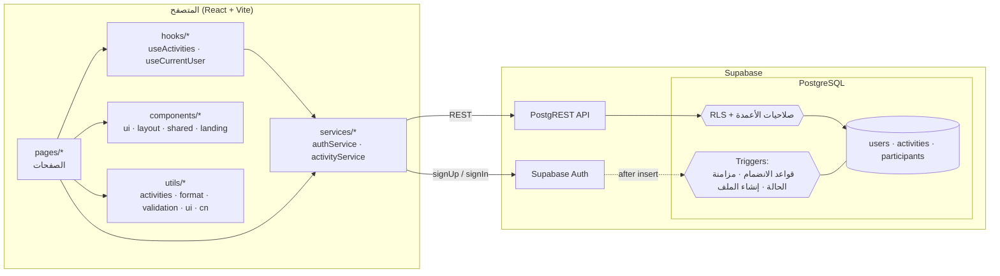
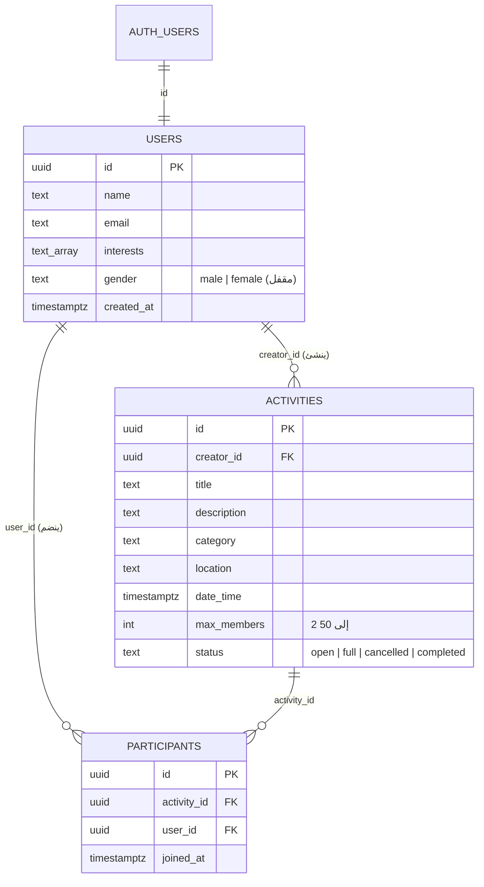

# رِفقة | RIFQAH

> «كل تجربة أحلى برفقة»

منصة ويب تجمع الناس حول الأنشطة المحلية: هوايات، رياضة، فنون، ولقاءات اجتماعية.  
تصفّح الأنشطة القريبة، احجز مقعدك بضغطة، أو أنشئ نشاطك الخاص وادعُ الآخرين للانضمام.

**التقنيات:** React 19 · Vite · Tailwind CSS v4 · Supabase (PostgreSQL + Auth + RLS) · خط ثمانية (OpenType محلي)

---

## 1. المشكلة

### وش هي المشكلة؟
العثور على شريك لممارسة هواية (بادل، قراءة، هايكنج، رسم) أو حضور فعالية في مدينتك تجربة مشتتة وغير منظمة. الأنشطة موزعة بين مجموعات واتساب عشوائية، منشورات متفرقة على إكس، أو مبادرات فردية تضيع في خوارزميات التواصل الاجتماعي.

### مين يعاني منها؟
1. **المبادرون والشغوفون:** من لديهم فكرة نشاط ولا يملكون أداة واضحة وموثوقة لإدارة المقاعد والعدد، فيحدث إما فراغ محبط أو تكدس غير متوقع.
2. **الباحثون عن رفقة:** أفراد جدد في المدينة أو يرغبون بتجربة شيء جديد، لكن لا يجدون من يشاركهم نفس الاهتمام بنفس الوقت.
3. **المجتمع المحلي:** فئات تفضل الانضمام لأنشطة مقتصرة على نفس الجنس التزاماً بالراحة والخصوصية الاجتماعية.

### ليش تستاهل تنحل؟
اللقاءات الواقعية تبني مجتمعات حقيقية وتقلل العزلة الاجتماعية. غياب أداة سهلة وموثوقة يحرم الناس من استغلال أوقاتهم وتطوير هواياتهم. حلها يوفر "محطة واحدة" آمنة وواضحة تربط المنظّم بالمهتمين بضغطة زر.

---

## 2. الحل

### وش اللي بنيناه؟
منصة تركز على التجربة الجوهرية (Core Loop) بدون أي تعقيد:

| ما يفعله المستخدم | كيف تدعمه المنصة |
|---|---|
| **يكتشف ويتصفح** | صفحة استكشاف ببحث سريع وست فئات رئيسية، متاحة للزوار دون إجبار على التسجيل الفوري |
| **ينضم بضمان** | حجز مقعد بضغطة زر مع حماية تامة من امتلاء العدد أو تكرار الانضمام على مستوى قاعدة البيانات |
| **ينشئ وينظّم** | نموذج إنشاء نشاط مباشر بتحقق دقيق من التاريخ والمكان والحد الأقصى للمقاعد |
| **يدير أنشطته** | مساحة شخصية («مساحتي») لمتابعة الأنشطة المنشأة، الأنشطة المنضم إليها، وإمكانية الإلغاء أو الانسحاب |
| **يشوف اللي يناسبه** | **فلترة تلقائية بالكامل حسب الجنس**، يرى المستخدم الأنشطة المطابقة له دون الحاجة لضبط أي فلاتر |

### وش اللي قررنا ما نبنيه، وليش؟ (Scope Decisions)
اتخذنا قرارات واعية بعدم بناء الميزات التالية في هذه المرحلة للتركيز على جودة المنتج وسرعة وصوله للمستخدمين:

1. **خادم وسيط منفصل (Express/Node Backend):**  
   *السبب:* نطاق المشروع هو إدارة أنشطة ومصادقة مستخدمين. استخدام Supabase كـ Backend-as-a-Service مكننا من استثمار كامل الوقت في جودة الواجهة وتجربة المستخدم، مع نقل الأمان وقواعد العمل الحساسة داخل PostgreSQL.
2. **غرف الدردشة الفورية (Chat/Realtime Messaging):**  
   *السبب:* إضافة محادثات فورية يفتح باباً كبيراً لمتطلبات الإشراف والخصوصية وإشغالات البنية التحتية. حالياً يعتمد النشاط على تحديد الموقع والوقت بوضوح في صفحة التفاصيل، وهو كافٍ تماماً للقاء الأولي.
3. **نظام دفع إلكتروني (Payment Gateway):**  
   *السبب:* كل الأنشطة الحالية مجتمعية ومجانية. تجنب التعقيدات المحاسبية وبوابات الدفع يحافظ على بساطة التجربة وبناء الثقة أولاً.
4. **رفع الصور المخصصة (Custom Image Uploads):**  
   *السبب:* بدلاً من استهلاك التخزين ومواجهة مشاكل الصور المخالفة أو بطء التحميل، اعتمدنا صوراً توضيحية خفيفة عالية الجودة (WebP) مرتبطة بكل فئة وتُعرض تلقائياً.

---

## 3. المعمارية

الواجهة الأمامية تتصل مباشرة مع Supabase. الأمان والقواعد الحرجة مفروضة ومحمية داخل قاعدة البيانات مباشرة (Row Level Security و Triggers):



### نموذج البيانات (Data Model)



### هيكل المشروع (Project Structure)

```
rifqah/
├── public/
│   ├── fonts/                # خطوط ثمانية و IBM Plex المحلية
└── src/
    ├── pages/                # الصفحات (Home, Explore, ActivityDetails, ...)
    ├── components/
    │   ├── ui/               # مكونات الواجهة التأسيسية (Field, Badges, SeatsMeter, ...)
    │   ├── layout/           # مكونات الهيكل والتنقل (Navbar, SiteFooter, Logo, ...)
    │   ├── shared/           # مكونات مشتركة بين عدة صفحات (ActivityCard, PersonAvatar, ...)
    │   └── landing/          # أقسام الصفحة الرئيسية الحصرية (Hero, Features, ...)
    ├── hooks/                # هوكات مخصصة (useActivities, useCurrentUser)
    ├── services/             # خدمات الاتصال بقاعدة البيانات والمصادقة
    ├── utils/                # أدوات مساعدة ومنطق تحويل البيانات والتحقق والتنسيق
    ├── index.css             # Tailwind v4 + رموز الألوان والخطوط المحلية
    ├── App.jsx               # مسارات الراوتر وحالة الجلسة
    └── main.jsx
```

---

## 4. القرارات التقنية

### 1. معمارية بدون خادم (Direct-to-Supabase)
استخدام Supabase مع React ألغى الحاجة لصيانة خادم Node/Express وسيط. المقابل لهذا الخيار هو ضرورة حماية العمليات الحساسة في قاعدة البيانات نفسها وليس في كود الواجهة.

### 2. حماية المقاعد الذرية (Atomic Seat Protection)
فحص «هل بقي مقعد؟» في كود الواجهة أو الـ API وحده يفشل عند ضغط مستخدمين اثنين زر الانضمام بنفس الجزء من الثانية (Race Condition).  
**الحل:** trigger داخل `01_seat_rules.sql` يطلب قفل الصف (`SELECT ... FOR UPDATE`) قبل كل عملية إدخال في جدول المشاركين، ويفحص العدد والموعد والحالة، فترفض الطلبات المتأخرة برسالة `ACTIVITY_FULL`.

| القاعدة | أين تُفرض |
|---|---|
| عدم الانضمام مرتين | قيد `unique_user_activity` |
| عدم تجاوز `max_members` | Trigger بقفل الصف (`ACTIVITY_FULL`) |
| منع الانضمام لنشاط ملغي أو منتهٍ | Trigger يفحص الحالة والموعد |
| المنظم لا ينضم لنشاطه | Trigger (`HOST_CANNOT_JOIN`) |
| تحويل الحالة تلقائياً `open ⇄ full` | Trigger بعد الإدخال والانسحاب |
| قفل الجنس بعد التسجيل | صلاحيات أعمدة PostgreSQL (GRANT UPDATE على name, interests فقط) |

### 3. إخفاء البريد وحماية الخصوصية عبر Column Grants
جدول `users` يحتوي على بيانات حساسة (البريد الإلكتروني). سياسات RLS العادية تقيّد الصفوف كاملة ولا تحجب أعمدة بعينها.  
**الحل:** منح صلاحية القراءة العامة للأعمدة `(id, name, gender, interests, created_at)` فقط، ومنع الوصول لعمود `email` عبر الـ API. البريد يأتي فقط من جلسة المصادقة الموثقة للشخص نفسه.

### 4. الفلترة التلقائية بالجنس عبر `!inner`
`getActivities(gender)` يستخدم `users:creator_id!inner(...)` مع شرط المطابقة. كلمة `!inner` حاسمة في PostgREST، وبدونها يُرجع الاستعلام كل الأنشطة ويجعل بيانات المنظّم غير المطابق `null` فقط دون أن يستبعد النشاط.

### 5. الخطوط المحلية وتحسينات OpenType
تم إلغاء الاعتماد على شبكات الخطوط الخارجية (Google Fonts) وتحميل خط **ثمانية** (Thmanyah Serif Display) و **IBM Plex Sans Arabic** محلياً داخل المشروع:
- تفعيل ميزات الـ OpenType الخاصة بخط ثمانية برمجياً (`salt`, `dlig`, `swsh`, `mark`, `mkmk`) لضمان محاذاة الحركات تلقائياً وظهور الحروف المرسلة الممتدة كما صُممت.
- توفير كلاس `.font-stretched` لمط الحروف والعناوين بسلاسة.

### 6. إعادة هيكلة الكود وفصل الطبقات (Clean Architecture)
- استبدال طبقة `lib/` بمجلد `utils/` بأدوار واضحة وصريحة (`activities`, `validation`, `format`, `ui`, `cn`, `errors`).
- فرز المكونات إلى `ui` (عناصر نقية)، `layout` (هيكل عام)، `shared` (مكونات مشتركة)، و `landing` (أقسام الهبوط).
- استخراج حالة المستخدم العامة داخل هوك موحد `useCurrentUser` لتخفيف الحمل عن `App.jsx`.

---

## 5. الحدود ونقاط الضعف الحالية (Limitations & What's Next)

### وش نقاط الضعف الحالية؟
- **الفلترة بالجنس مطلوبة من الواجهة:** الأمان مفروض كاستعلام، لكن مستخدماً تقنياً يملك المفتاح العام يمكنه قراءة أنشطة الطرف الآخر عبر استعلام مباشر لـ PostgREST.
- **غياب التحديث اللحظي (No Realtime WebSockets):** عند اكتمال مقاعد نشاط، لا يرى المشاهد الآخر التحديث إلا بعد إعادة تحميل الصفحة أو محاولة الانضمام.
- **عدم وجود ترقيم صفحات (Pagination):** استعلام الأنشطة يجلب كامل السجلات دفعة واحدة، وهو كافٍ للبدايات لكنه غير ملائم مع نمو البيانات.
- **المطابقة بالاهتمامات:** اهتمامات المستخدم تُخزن في حسابه، لكنها لا تُستخدم حالياً في إعادة ترتيب الأنشطة المعروضة له.

### وش بيتغيّر لو صار عندك وقت أكثر أو مستخدمين أكثر؟
1. **نقل فلترة الجنس إلى سياسة RLS صارمة:** بحيث ترجع قاعدة البيانات صفراً من النتائج لمن يحاول استعراض أنشطة غير مطابقة لجنسه.
2. **تفعيل Supabase Realtime:** تفعيل قنوات البث اللحظي لتحديث شريط المقاعد وحالة النشاط على شاشات المشاهدين فور انضمام أي شخص.
3. **Infinite Scroll / Pagination:** تطبيق التمرير اللانهائي في صفحة الاستكشاف لتخفيف استهلاك الشبكة.
4. **خوارزمية ترشيح مبنية على الاهتمامات المشتركة:** ترتيب الأنشطة الأعلى في الصفحة بحسب تقاطع اهتمامات المستخدم مع وسوم النشاط.
5. **رفع الصور عبر Supabase Storage:** إتاحة رفع صور حقيقية للمكان والفعالية مع فحص آلي للأبعاد والحجم.

---
## 6. طريقة التشغيل والتجربة
يمكنك تجربة منصة رِفقة بإحدى الطريقتين:

### 1. تجربة المنصة مباشرة

لا تحتاج إلى تثبيت أي شيء، يمكنك زيارة الموقع وتجربة المنصة مباشرة:

 **[جرّب منصة رِفقة – RIFQAH](https://riifqah.netlify.app)**

### 2. طريقة التشغيل محلياً

**المتطلبات:** Node.js 20+

```bash
# 1. استنساخ المشروع وتثبيت الحزم
git clone <رابط-المستودع>
cd RIFQAH
npm install

# 2. إعداد المتغيرات البيئية
cp .env.example .env
```

املأ القيم داخل ملف `.env` (تجدها في إعدادات مشروع Supabase الخاص بك: Project Settings ← API):
```env
SUPABASE_URL=https://xxxx.supabase.co
SUPABASE_ANON_KEY=eyJ...
```

**3. تشغيل خادم التطوير:**
```bash
npm run dev       # تشغيل على http://localhost:5173
npm run build     # فحص البناء النهائي
npm run lint      # فحص معايير الكود
```

---

## 7. سيناريو الاختبار اليدوي

1. **الزائر:** ادخل صفحة `/explore` بدون تسجيل، جرّب البحث والفلترة بالفئات. اضغط «عرض التفاصيل» ← ستُحوَّل تلقائياً إلى صفحة الدخول.
2. **الفلترة بالجنس:** أنشئ حساباً كـ "أنثى"، ثم أنشئ حساباً كـ "ذكر" في متصفح خفي؛ ستلاحظ أن كل حساب يرى فقط الأنشطة التي تناسبه.
3. **حماية المقاعد:** أنشئ نشاطاً بمقعدين، انضم من حساب آخر، ثم حاول الانضمام بحساب ثالث بعد امتلاء المقاعد لتظهر رسالة «اكتمل العدد».
4. **المغادرة والإلغاء:** جرّب مغادرة النشاط ليتاح المقعد فوراً، أو إلغاء النشاط من مساحتك ليظهر للمشاركين بحالة «ملغي».
5. **الملف الشخصي:** عدّل الاسم والاهتمامات؛ حقل الجنس يظل مقفلاً دائماً لحماية منطق الفلترة.

---

## 8. سير العمل في Git

```
main                (النسخة المستقرة النهائية)
 └── dev            (تجميع الميزات والتطوير المستمر)
      └── feature/<name>   → طلب دمج (PR) إلى dev
```

تتبع الالتزامات معايير [Conventional Commits](https://www.conventionalcommits.org):  
`feat(scope): ...` · `fix(scope): ...` · `refactor(scope): ...` · `style: ...` · `docs: ...`
